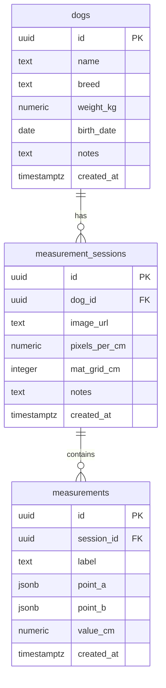

# ER 図 — 犬用車椅子採寸プラットフォーム

## Mermaid ER 図



---

## テーブル定義

### dogs

| カラム | 型 | 制約 | 説明 |
|---|---|---|---|
| id | uuid | PK, default gen_random_uuid() | - |
| name | text | NOT NULL | 犬の名前 |
| breed | text | - | 犬種 |
| weight_kg | numeric(5,2) | - | 体重(kg) |
| birth_date | date | - | 生年月日 |
| notes | text | - | メモ |
| created_at | timestamptz | default now() | - |

### measurement_sessions

| カラム | 型 | 制約 | 説明 |
|---|---|---|---|
| id | uuid | PK, default gen_random_uuid() | - |
| dog_id | uuid | FK → dogs.id | - |
| image_url | text | - | Supabase Storage URL |
| pixels_per_cm | numeric(10,4) | - | スケールキャリブレーション結果 |
| mat_grid_cm | integer | default 5 | グリッド間隔(cm) |
| notes | text | - | メモ |
| created_at | timestamptz | default now() | - |

### measurements

| カラム | 型 | 制約 | 説明 |
|---|---|---|---|
| id | uuid | PK, default gen_random_uuid() | - |
| session_id | uuid | FK → measurement_sessions.id | - |
| label | text | NOT NULL | 採寸ラベル（胴長・肩高 等） |
| point_a | jsonb | NOT NULL | 始点 {x: number, y: number}（ピクセル） |
| point_b | jsonb | NOT NULL | 終点 {x: number, y: number}（ピクセル） |
| value_cm | numeric(8,2) | NOT NULL | 計算値(cm) |
| created_at | timestamptz | default now() | - |

---

## Supabase SQL（初期セットアップ用）

```sql
-- dogs
create table dogs (
  id uuid primary key default gen_random_uuid(),
  name text not null,
  breed text,
  weight_kg numeric(5,2),
  birth_date date,
  notes text,
  created_at timestamptz default now()
);

-- measurement_sessions
create table measurement_sessions (
  id uuid primary key default gen_random_uuid(),
  dog_id uuid references dogs(id) on delete cascade,
  image_url text,
  pixels_per_cm numeric(10,4),
  mat_grid_cm integer default 5,
  notes text,
  created_at timestamptz default now()
);

-- measurements
create table measurements (
  id uuid primary key default gen_random_uuid(),
  session_id uuid references measurement_sessions(id) on delete cascade,
  label text not null,
  point_a jsonb not null,
  point_b jsonb not null,
  value_cm numeric(8,2) not null,
  created_at timestamptz default now()
);

-- ── RLS 有効化（Phase 1: anon に全操作を許可） ──────────────

alter table dogs enable row level security;
alter table measurement_sessions enable row level security;
alter table measurements enable row level security;

-- dogs
create policy "anon_all_dogs" on dogs
  for all to anon using (true) with check (true);

-- measurement_sessions
create policy "anon_all_sessions" on measurement_sessions
  for all to anon using (true) with check (true);

-- measurements
create policy "anon_all_measurements" on measurements
  for all to anon using (true) with check (true);

-- ── Phase 2 移行時にやること ────────────────────────────────
-- 上記 3 つの anon ポリシーを DROP し、
-- authenticated ロール向けに owner_id カラムを使った
-- ユーザー別ポリシーに差し替える。
-- drop policy "anon_all_dogs" on dogs;
-- create policy "owner_dogs" on dogs
--   for all to authenticated
--   using (owner_id = auth.uid())
--   with check (owner_id = auth.uid());
```

---

## 将来拡張（Phase 3+）

Phase 3 以降で以下のテーブルを追加予定:

- `keypoints` — AI が推定した犬のキーポイント座標
- `gait_analyses` — 動画から取得した歩行指標
- `wheelchair_recommendations` — 推薦車椅子サイズ
- `users` — Supabase Auth と連携（Phase 2）
