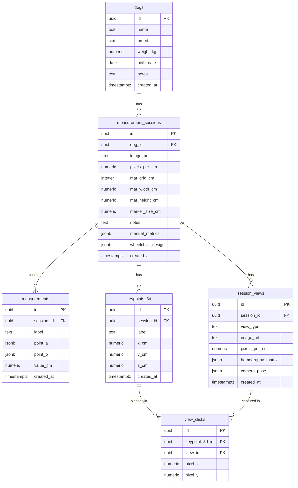

# 犬用車椅子採寸プラットフォーム — システム仕様書

**バージョン**: Phase 3b 実装済み（commit `999e412`）  
**更新日**: 2026-06-21

---

## 1. システム概要

犬を複数アングルから撮影し、ArUco マーカー付きマットを使って 3D 体軸座標を推定する採寸プラットフォーム。得られた座標から車椅子サイズに必要な計測値（肩高・胴長・肩幅等）を算出する。

### 実装フェーズ

| フェーズ | 内容 | 状態 |
|---|---|---|
| Phase 1 | 手動キャリブレーション（2点クリック → pixels/cm）| 完了 |
| Phase 2 | ArUco 自動スケール検出（`DICT_4X4_50`、4隅マーカー）| 完了 |
| Phase 3a | ホモグラフィ射影補正（1枚の画像内カメラ傾き補正）| 完了 |
| Phase 3b | solvePnP 両面カメラ姿勢推定（床＋壁 L字配置）| 完了 |

---

## 2. アーキテクチャ

```
┌─────────────────────────────┐     HTTP      ┌──────────────────────────┐
│  Next.js 16.2.9 (App Router)│  ←──────────→ │  FastAPI + Uvicorn       │
│  React 19 / TypeScript       │               │  Python + OpenCV         │
│  Tailwind CSS v4             │               │  localhost:8000          │
│  localhost:3000              │               └──────────────────────────┘
└──────────────┬──────────────┘
               │ Supabase JS SDK
               ▼
       ┌───────────────┐
       │   Supabase    │
       │ PostgreSQL DB │
       │ Storage Bucket│
       │  "sessions"   │
       └───────────────┘
```

### ページ構成

```
/                          # ホーム
/dogs/new                  # 犬プロフィール登録
/dogs/[id]                 # 犬詳細・セッション一覧
/sessions/new              # 採寸セッション作成
/sessions/[id]             # セッション概要
/sessions/[id]/3d          # 3D キーポイント配置エディタ（メイン）
/sessions/[id]/export      # 計測値エクスポート
```

---

## 3. データモデル

### 3.1 ER 図



### 3.2 テーブル定義

#### dogs

| カラム | 型 | 説明 |
|---|---|---|
| id | uuid PK | - |
| name | text NOT NULL | 犬の名前 |
| breed | text | 犬種 |
| weight_kg | numeric(5,2) | 体重 kg |
| birth_date | date | 生年月日 |
| notes | text | メモ |
| created_at | timestamptz | - |

#### measurement_sessions

| カラム | 型 | 説明 |
|---|---|---|
| id | uuid PK | - |
| dog_id | uuid FK → dogs.id | - |
| image_url | text | Storage URL（レガシー） |
| pixels_per_cm | numeric(10,4) | レガシースケール |
| mat_grid_cm | integer | グリッド間隔（レガシー） |
| mat_width_cm | numeric | マット幅（四隅マーカー中心間距離 cm） |
| mat_height_cm | numeric | マット高さ（四隅マーカー中心間距離 cm） |
| marker_size_cm | numeric | マーカー1辺の実寸 cm（0 = 中心点のみ使用） |
| notes | text | メモ |
| created_at | timestamptz | - |

#### session_views

| カラム | 型 | 説明 |
|---|---|---|
| id | uuid PK | - |
| session_id | uuid FK | - |
| view_type | text | `top` / `side_left` / `side_right` / `front` / `back` |
| image_url | text | Storage URL |
| pixels_per_cm | numeric(10,4) | ArUco 自動検出 or 手動キャリブ値 |
| homography_matrix | jsonb | `number[9]` 行優先 3×3 射影変換行列（null = 非使用） |
| camera_pose | jsonb | `{C: [x,y,z], RT_Kinv: number[9]}`（null = 非使用） |
| created_at | timestamptz | - |

#### keypoints_3d

| カラム | 型 | 説明 |
|---|---|---|
| id | uuid PK | - |
| session_id | uuid FK | - |
| label | text NOT NULL | 部位名（右前足付け根、肩甲骨上端 など） |
| x_cm | numeric | 体軸 X（頭方向 +） |
| y_cm | numeric | 体軸 Y（犬の右方向 +） |
| z_cm | numeric | 高さ Z（上方向 +） |
| created_at | timestamptz | - |

#### view_clicks

| カラム | 型 | 説明 |
|---|---|---|
| id | uuid PK | - |
| keypoint_3d_id | uuid FK | - |
| view_id | uuid FK | - |
| pixel_x | numeric | クリックしたピクセル X |
| pixel_y | numeric | クリックしたピクセル Y |

#### measurements（レガシー）

| カラム | 型 | 説明 |
|---|---|---|
| id | uuid PK | - |
| session_id | uuid FK | - |
| label | text NOT NULL | 採寸ラベル |
| point_a | jsonb | 始点 `{x, y}` |
| point_b | jsonb | 終点 `{x, y}` |
| value_cm | numeric(8,2) | 計算値 cm |
| created_at | timestamptz | - |

### 3.3 DB マイグレーション（Phase 2/3 で追加）

```sql
-- Phase 2: measurement_sessions にマット寸法追加
ALTER TABLE measurement_sessions
  ADD COLUMN IF NOT EXISTS mat_width_cm  NUMERIC DEFAULT 84;
ALTER TABLE measurement_sessions
  ADD COLUMN IF NOT EXISTS mat_height_cm NUMERIC DEFAULT 119;

-- Phase 2: 3D 計測用テーブル群
CREATE TABLE IF NOT EXISTS session_views (
  id           uuid primary key default gen_random_uuid(),
  session_id   uuid references measurement_sessions(id) on delete cascade,
  view_type    text not null,
  image_url    text,
  pixels_per_cm numeric(10,4),
  created_at   timestamptz default now()
);

CREATE TABLE IF NOT EXISTS keypoints_3d (
  id           uuid primary key default gen_random_uuid(),
  session_id   uuid references measurement_sessions(id) on delete cascade,
  label        text not null,
  x_cm         numeric,
  y_cm         numeric,
  z_cm         numeric,
  created_at   timestamptz default now()
);

CREATE TABLE IF NOT EXISTS view_clicks (
  id               uuid primary key default gen_random_uuid(),
  keypoint_3d_id   uuid references keypoints_3d(id) on delete cascade,
  view_id          uuid references session_views(id) on delete cascade,
  pixel_x          numeric not null,
  pixel_y          numeric not null
);

-- Phase 3a/3b: session_views にホモグラフィ・カメラ姿勢追加
ALTER TABLE session_views
  ADD COLUMN IF NOT EXISTS homography_matrix JSONB DEFAULT NULL;
ALTER TABLE session_views
  ADD COLUMN IF NOT EXISTS camera_pose       JSONB DEFAULT NULL;

-- Phase 3b: marker_size_cm 追加
ALTER TABLE measurement_sessions
  ADD COLUMN IF NOT EXISTS marker_size_cm NUMERIC DEFAULT 0;
```

### 3.4 Supabase Storage

バケット名: `sessions`

```
sessions/
└── {session_id}/
    └── 3d_{view_type}.{ext}   # 例: 3d_top.jpg, 3d_side_left.png
```

---

## 4. ArUco マット設計

### 4.1 マーカー仕様

- **辞書**: `DICT_4X4_50`（デフォルト）
- **ID 割り当て**:
  - 床マット: ID 0（TL）、1（TR）、2（BL）、3（BR）
  - 壁マット: ID 4（TL）、5（TR）、6（BL）、7（BR）

### 4.2 L 字配置（Phase 3b 使用時）

```
           Z（上）
           │
           │  ┌──────────────┐  ← 壁マット（ID 4–7、Y=0 面）
           │  │ TL(4)  TR(5) │
           │  │              │
 5cm余白 → │  │ BL(6)  BR(7) │
           │  └──────────────┘
5cm余白 ↓  ├──┬──────────────┐
           O  │ TL(0)  TR(1) │  ← 床マット（ID 0–3、Z=0 面）
              │              │
  5cm余白 →   │ BL(2)  BR(3) │
              └──────────────┘
              ←── Y（奥行き）───
```

- 床マット前端（TL-TR 辺）を壁の根本に合わせる
- 壁マット下端（BL-BR 辺）が床に接するように配置
- **各マットの端から 5cm 内側**にマーカー中心があるため、物理コーナーとマーカー中心は一致しない

### 4.3 solvePnP 用 3D ワールド座標

原点 = 床-壁の物理接合コーナー。M = 5.0 cm（マージン）、W = `mat_width_cm`、H = `mat_height_cm`。

```
床マット（Z=0）:
  ID 0 (TL): (M,     M,     0)   = (5,     5,     0)
  ID 1 (TR): (M+W,   M,     0)   = (W+5,   5,     0)
  ID 2 (BL): (M,     M+H,   0)   = (5,     H+5,   0)
  ID 3 (BR): (M+W,   M+H,   0)

壁マット（Y=0）:
  ID 4 (TL): (M,     0,   M+H)   = (5,     0,     H+5)
  ID 5 (TR): (M+W,   0,   M+H)
  ID 6 (BL): (M,     0,   M)     = (5,     0,     5)
  ID 7 (BR): (M+W,   0,   M)
```

Floor TL (ID 0) = (5,5,0) と Wall BL (ID 6) = (5,0,5) は異なる 3D 点（重複なし）。

---

## 5. バックエンド API

### 5.1 構成

```
backend/
├── app/
│   ├── main.py           # FastAPI app、CORS、ルーター登録
│   └── api/
│       ├── aruco.py      # ArUco マーカー検出・カメラ姿勢推定
│       └── mat_pdf.py    # 採寸マット PDF 生成
```

ベース URL: `http://localhost:8000/api/v1`

### 5.2 POST /detect-aruco

ArUco マーカーを検出してスケール・ホモグラフィ・カメラ姿勢を返す。

**リクエスト** (`multipart/form-data`):

| フィールド | 型 | 必須 | 説明 |
|---|---|---|---|
| file | binary | ✓ | 撮影画像 |
| mat_width_cm | float | ✓ | 四隅マーカー中心間の幅 cm |
| mat_height_cm | float | ✓ | 四隅マーカー中心間の高さ cm |
| dictionary | string | - | デフォルト `DICT_4X4_50` |
| marker_size_cm | float | - | マーカー1辺の実寸 cm（デフォルト 0 = 中心点のみ） |

**検出フロー**:

1. 画像デコード → グレースケール
2. CLAHE でコントラスト強調
3. 4段階のパラメータで検出試行（通常→CLAHE→ルーズ→CLAHE+ルーズ）
4. マーカー中心 dict と corners dict を構築
5. 床 / 壁どちらをより多く検出したか判定してスケール計算
6. 4コーナー全検出 → ホモグラフィ計算
7. 床＋壁両方検出 → solvePnP でカメラ姿勢推定

**レスポンス**:

```json
{
  "pixels_per_cm": 15.3242,
  "markers_found": 4,
  "pairs_used": 4,
  "corners_normalized": [
    { "id": 0, "x": 0.1234, "y": 0.2345 }
  ],
  "homography_matrix": [h00, h01, ..., h22],
  "camera_pose": {
    "C": [cx, cy, cz],
    "RT_Kinv": [r00, r01, ..., r22]
  }
}
```

`homography_matrix` / `camera_pose` は条件未達成時 `null`。

**スケール計算**:

```
横ペア (TL-TR, BL-BR) → pixel距離 / mat_width_cm
縦ペア (TL-BL, TR-BR) → pixel距離 / mat_height_cm
全ペアの平均 → pixels_per_cm
```

**ホモグラフィ計算（4コーナー全揃い時）**:

```python
src = [TL_px, TR_px, BL_px, BR_px]   # ピクセル座標
dst = [(0,0), (W,0), (0,H), (W,H)]   # マット cm 座標
H = cv2.getPerspectiveTransform(src, dst)   # 3×3 行列
```

**solvePnP（床＋壁マーカー両方検出時）**:

- `marker_size_cm > 0` の場合: マーカー4角を使用（最大 32 点で高精度）
- `marker_size_cm = 0` の場合: マーカー中心のみ使用（最大 8 点）
- 焦点距離初期値: `f = max(image_width, image_height)` ピクセル
- アルゴリズム: `SOLVEPNP_ITERATIVE`
- 出力: `C = -R^T · t`（カメラ中心）、`RT_Kinv = R^T · K^{-1}`（逆射影行列）

**マーカー4角オフセット定義**（S = marker_size_cm / 2）:

```
床マーカー（Z=0 面）— 順序 TL, TR, BR, BL（時計回り）:
  [0]: (cx-S, cy-S, 0)
  [1]: (cx+S, cy-S, 0)
  [2]: (cx+S, cy+S, 0)
  [3]: (cx-S, cy+S, 0)

壁マーカー（Y=0 面）:
  [0]: (cx-S, 0, cz+S)
  [1]: (cx+S, 0, cz+S)
  [2]: (cx+S, 0, cz-S)
  [3]: (cx-S, 0, cz-S)
```

### 5.3 POST /debug-aruco

検出失敗原因を調べるデバッグ用。4 辞書 × 通常/CLAHE の組み合わせ結果を返す。

### 5.4 GET /test-aruco

ライブラリ動作確認。ID 0 を生成して検出できれば `{"status": "ok"}` を返す。

### 5.5 POST /generate-mat-pdf

採寸マット PDF を生成してダウンロード返却。紙サイズ: A4/A3/A4L/A3L。

---

## 6. フロントエンド

### 6.1 構成

```
frontend/src/
├── app/                    # Next.js App Router ページ
├── components/
│   ├── measurement/
│   │   ├── Keypoint3DList.tsx   # キーポイント一覧・ラベル選択
│   │   ├── ViewCanvas.tsx       # 画像クリックキャンバス
│   │   └── ViewUploader.tsx     # ビュー画像アップロード
│   └── ui/                 # 汎用 UI コンポーネント
├── hooks/
│   ├── use3DSession.ts     # 3D セッション状態管理（メインフック）
│   └── useDogs.ts
├── lib/
│   ├── aruco-api.ts        # バックエンド呼び出し
│   ├── coords-3d.ts        # 座標変換ユーティリティ
│   └── supabase.ts         # Supabase クライアント
└── types/index.ts          # 全型定義
```

### 6.2 犬体軸座標系

```
X+ = 頭方向（前）
X- = 尾方向（後）
Y+ = 犬の右方向
Y- = 犬の左方向
Z+ = 上（高さ）
Z- = 下
```

### 6.3 ビュー軸マッピング（VIEW_AXIS_MAP）

各ビューのピクセル軸を犬体軸にマッピング。px = 水平軸、py = 垂直軸。

| ビュー | px_axis | px_inverted | py_axis | py_inverted |
|---|---|---|---|---|
| top（真上） | x_cm | true | y_cm | true |
| side_left（左側面） | x_cm | true | z_cm | true |
| side_right（右側面） | x_cm | false | z_cm | true |
| front（正面） | y_cm | false | z_cm | true |
| back（背面） | y_cm | true | z_cm | true |

### 6.4 座標変換関数（`frontend/src/lib/coords-3d.ts`）

#### pixelToWorld（フォールバック）

```
pixel → body座標（均一スケール）
入力: pixel(x,y)、pixels_per_cm、画像サイズ
出力: 体軸2座標（ビューで見える軸のみ）
```

#### pixelToWorldH（Phase 3a 使用）

```
pixel → body座標（ホモグラフィ補正あり）
入力: pixel(x,y)、H[9]、view_type、mat_width_cm、mat_height_cm
```

#### applyHomography

```
H[9] × (px, py) → マット cm 座標 (x, y)
w = H[6]*px + H[7]*py + H[8]
x = (H[0]*px + H[1]*py + H[2]) / w
y = (H[3]*px + H[4]*py + H[5]) / w
```

#### unprojectRay

```
(px, py) + CameraPose → ワールド空間の光線方向ベクトル d
d = RT_Kinv[3×3] × [px, py, 1]^T
```

#### intersectPlaneZ（Phase 3b 使用）

```
光線 C + t·d と 平面 Z=targetZ の交点 (x,y)
t = (targetZ - C.z) / d.z
返り値: ワールド座標 (x, y) または null（光線が水平な場合）
```

### 6.5 座標変換の優先順位（フォールバックチェーン）

```
1. view.homography_matrix あり → pixelToWorldH（Phase 3a）
2. homography なし            → pixelToWorld（均一スケール）
3. XY補正ボタン押下時         → intersectPlaneZ（Phase 3b）
   ※ top view に camera_pose があり、z_cm が既知の場合のみ
```

### 6.6 `use3DSession` フック

**状態（State）**:

```typescript
{
  views: SessionView[];           // アップロード済みビュー一覧
  keypoints: Keypoint3D[];        // 配置済みキーポイント
  clicks: ViewClick[];            // ビューごとのクリック記録
  activeViewId: string | null;
  selectedLabel: string;          // 現在選択中の部位ラベル
  matWidthCm: number;
  matHeightCm: number;
  markerSizeCm: number;
  viewCorners: Record<string, NormalizedCorner[]>;
  loading: boolean;
  saving: boolean;
  error: string | null;
}
```

**エクスポート関数**:

| 関数 | 説明 |
|---|---|
| `addView(viewType, file)` | 画像アップロード → ArUco 検出 → DB 保存 |
| `calibrateView(viewId, pixelDist, knownCm)` | 手動スケールキャリブ |
| `resetScale(viewId)` | スケールリセット |
| `placeClick(viewId, px, py, imgW, imgH)` | クリック → 3D 座標変換 → DB 保存 |
| `deleteKeypoint(id)` | キーポイント＋関連クリック削除 |
| `refineKeypointXY(keypointId)` | カメラ姿勢を使った XY 補正（手動） |
| `setActiveView(id)` | 表示ビュー切替 |
| `setLabel(label)` | 選択ラベル変更 |

### 6.7 XY 補正ロジック（refineKeypointXY）

条件: `keypoint.z_cm != null` かつ `top view の camera_pose != null`

```
1. top view クリック (pixel_x, pixel_y) を取得
2. intersectPlaneZ(pixel_x, pixel_y, camera_pose, z_cm) → world(x, y)
3. ワールド座標 → 体軸座標変換（M=5cm マージン補正）:
   relX = world.y - (5.0 + mat_height_cm / 2)  // 奥行き → 体前後(X軸)
   relY = world.x - (5.0 + mat_width_cm  / 2)  // 幅方向 → 体左右(Y軸)
   corrected_x = -relX   // top view: px_inverted=true
   corrected_y = -relY   // top view: py_inverted=true
4. keypoints_3d の x_cm, y_cm を更新
```

### 6.8 採寸部位プリセット（PRESET_LABELS）

```
右前足付け根 / 左前足付け根 / 右後足付け根 / 左後足付け根 / 頭頂 / 鼻先 / 肩甲骨上端 / 喉元 / 胸部 / 胸骨下部 / 尾根 / 尻 / 右前足首 / 左前足首 / 右後足首 / 左後足首
```

---

## 7. セッション作成フォーム

`/sessions/new` で入力するパラメータ:

| フィールド | デフォルト | 説明 |
|---|---|---|
| 犬の選択 | — | 必須 |
| 横（マット幅） | 84 cm | 四隅マーカー中心間距離 |
| 縦（マット高さ） | 119 cm | 四隅マーカー中心間距離 |
| マーカー実寸 | 0 cm | L字配置両面補正を使う場合のみ設定（0 = 中心点のみ） |

---

## 8. 計測ワークフロー

### 8.1 通常フロー（シングルマット）

1. 採寸マット PDF を印刷・配置
2. 犬をマット上に立たせて 5 方向から撮影
3. セッション作成（マット寸法を入力）
4. `/sessions/[id]/3d` を開く
5. 各ビューの画像をアップロード → ArUco 自動検出でスケール確定
6. 各部位を各ビューでクリック → 3D 座標が蓄積される
7. 全部位の X / Y / Z が揃ったら計測値を確認

### 8.2 両面 L 字配置フロー（Phase 3b）

1. 床マット（ID 0–3）＋壁マット（ID 4–7）を L 字に配置
2. セッション作成時に `marker_size_cm` を入力（マーカー実寸 cm）
3. 両マットが写る画像をアップロード → `camera_pose` が自動取得される
4. 通常通りクリックで座標入力
5. Z が確定したキーポイントは「XY 補正」ボタンで精度向上が可能

### 8.3 手動キャリブレーション（フォールバック）

ArUco 検出失敗時: マット上の既知距離を 2 点クリックして pixels_per_cm を手動設定。

---

## 9. 環境構成

### フロントエンド

```
frontend/.env.local:
NEXT_PUBLIC_SUPABASE_URL=...
NEXT_PUBLIC_SUPABASE_ANON_KEY=...
NEXT_PUBLIC_BACKEND_URL=http://localhost:8000
```

起動:
```bash
cd frontend && npm run dev   # localhost:3000
```

### バックエンド

```bash
cd backend
python -m venv .venv && source .venv/bin/activate
pip install -r requirements.txt
uvicorn app.main:app --reload   # localhost:8000
```

依存: `fastapi`, `uvicorn`, `opencv-contrib-python`, `numpy`, `reportlab`, `python-multipart`

---

## 10. 型定義サマリー（TypeScript）

```typescript
type CameraPose = {
  C: [number, number, number];   // ワールド座標カメラ中心
  RT_Kinv: number[];              // 9要素 row-major（R^T · K^-1）
};

type SessionView = {
  id: string;
  session_id: string;
  view_type: ViewType;
  image_url: string | null;
  pixels_per_cm: number | null;
  homography_matrix: number[] | null;   // Phase 3a
  camera_pose: CameraPose | null;       // Phase 3b
  created_at: string;
};

type Keypoint3D = {
  id: string;
  session_id: string;
  label: string;
  x_cm: number | null;   // 頭尾軸（頭 +）
  y_cm: number | null;   // 左右軸（犬の右 +）
  z_cm: number | null;   // 高さ（上 +）
  created_at: string;
};

type ViewType = "top" | "side_left" | "side_right" | "front" | "back";
```
